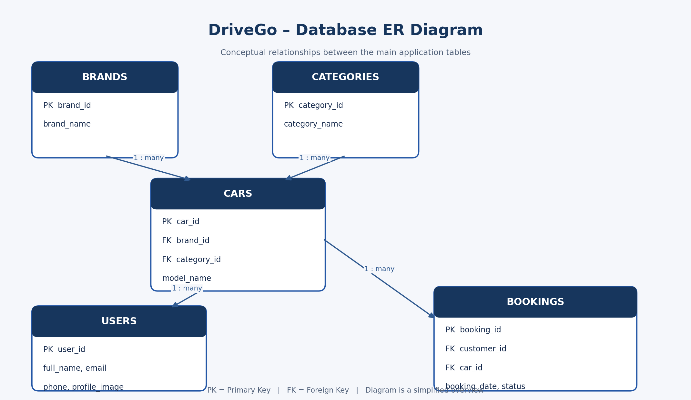

# 🚗 DriveGo – Car Rental Booking System

DriveGo is a PHP and MySQL-based web application for browsing rental cars and managing bookings through an admin dashboard.

## Features

- Responsive car rental website
- Browse and search available cars
- Customer registration and login
- Login-required booking access
- Admin dashboard and authentication
- Manage cars, brands and categories
- Manage customers, staff and bookings
- Search and filter bookings
- Admin profile, profile picture and password management

## Technologies

PHP · MySQL · HTML5 · CSS3 · Bootstrap 5 · JavaScript · Boxicons · XAMPP

## Database Design

The diagram below shows the main database relationships.



Main tables: `users`, `cars`, `brands`, `categories`, and `bookings`.

*This is a simplified conceptual diagram. Check the exported SQL file for the exact schema and constraints.*

## Run Locally

1. Install XAMPP and start Apache and MySQL.
2. Clone this repository into the XAMPP `htdocs` folder:

   ```bash
   git clone https://github.com/ianhint/DriveGo.git
   ```
3. Create a MySQL database named `car_rental_db`.
4. Import the project's exported SQL file (place it at `database/car_rental_db.sql`).
5. Update the database credentials in `config/dbconfig.php`.
6. Open the project in your browser. Example:

   `http://localhost/DriveGo/`

*Use the actual project URL and file paths if your folder structure is different.*

## Project Structure

```text
DriveGo/
├── admin/
├── frontend/
├── config/
├── includes/
├── assets/
├── database/
│   └── car_rental_db.sql
├── database-er-diagram.png
└── README.md
```

## Developer

**Ismail Hossain** · [GitHub @ianhint](https://github.com/ianhint)

---

**DriveGo – Your Journey, Our Cars!**
